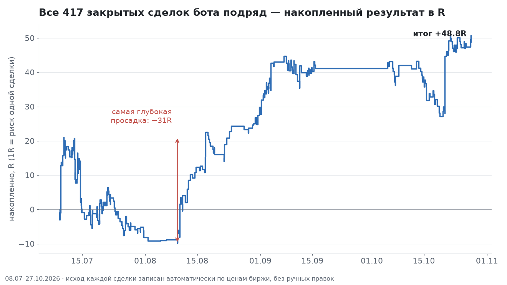
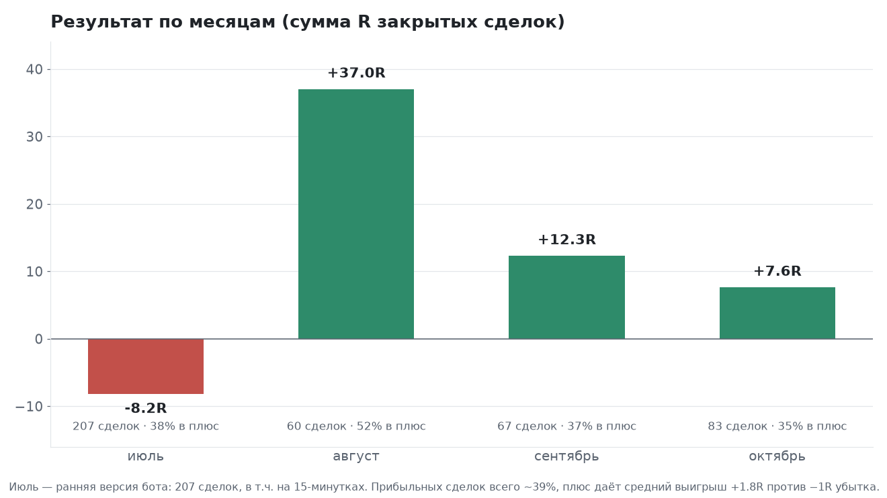
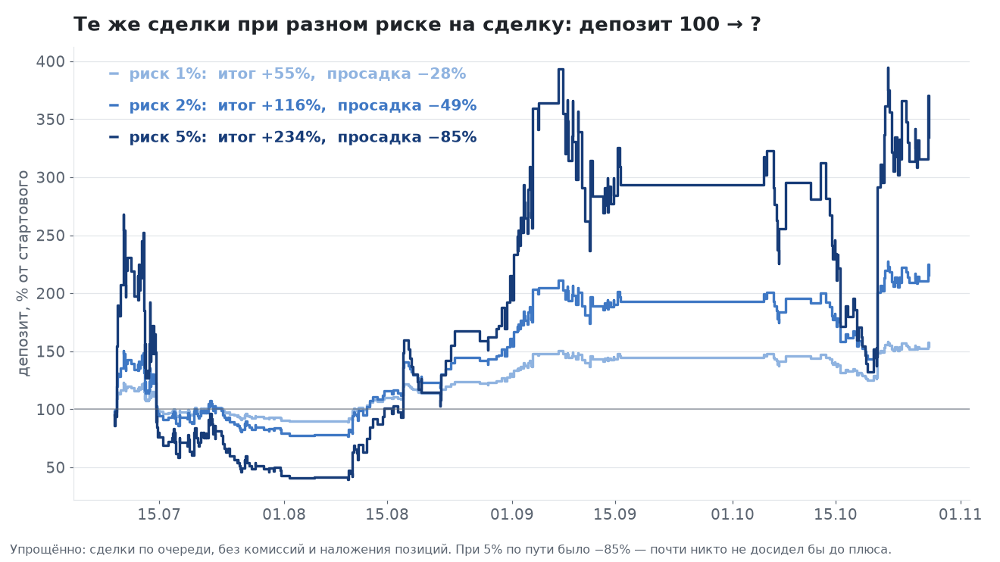
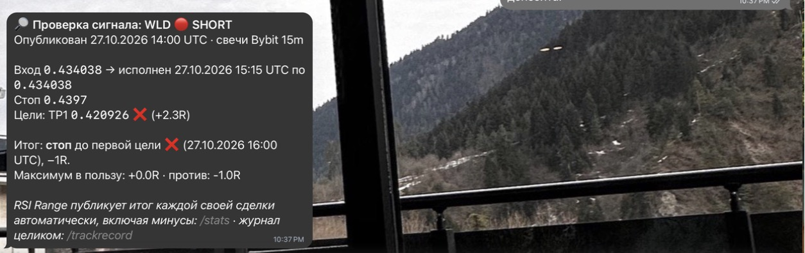

<!--
Для владельца (не публиковать этот блок):
* Площадки: Smart-Lab (блог), vc.ru (раздел «Крипта»), Пикабу (теги: криптовалюта, трейдинг, статистика).
* Ссылка на бота — СВОЯ на каждую площадку, чтобы /growth показал, откуда пришли:
  Smart-Lab  https://t.me/rsirange_bot?start=src_smartlab
  vc.ru      https://t.me/rsirange_bot?start=src_vc
  Пикабу     https://t.me/rsirange_bot?start=src_pikabu
  В тексте ниже стоит smartlab — для других площадок замени метку.
* Картинки: docs/growth/img/equity_r.png, monthly_r.png, risk_compare.png, check-demo.jpg.
* Цифры — журнал бота на 27.10.2026 (417 закрытых сделок). Названия сетапов НЕ раскрывать.
* На комментарии отвечать спокойно и с цифрами; «скам» — ссылка на CSV-журнал (/trackrecord).
-->

# Я публикую ВСЕ сделки своего крипто-бота, включая убыточные. 417 сделок: 39% в плюс — и почему это всё равно плюс

Почти каждый сигнальный канал показывает скрины с «+300%», а стопы куда-то пропадают. Я
решил сделать наоборот: бот публикует итог **каждой** сделки автоматически, по ценам биржи,
без ручных правок, а весь журнал можно скачать (CSV + контрольная сумма sha256). Прошло
3,5 месяца — делюсь цифрами как есть, с провалами, и тем, что я понял про риск, бэктесты и
«очевидные» улучшения, которые на проверке оказались вредными.

Это не реклама «пассивного дохода» и не финансовый совет. Это отчёт.

## Что за бот

Telegram-бот присылает сигналы по крипто-фьючерсам (USDT-перпетуалы, лонг и шорт): вход,
стоп, сопровождение. Логика — структура рынка (Smart Money Concepts) плюс RSI, рабочий
таймфрейм сейчас — 1 час. Выход — трейлинг-стопом: цель не фиксирована, прибыль тянется, пока рынок
идёт. Риск на сделку — фиксированный, поэтому дальше всё считаю в **R** (1R = сумма, которой
рискуешь в одной сделке; −1R — стоп, +2R — прибыль в два риска).

## Результат: 417 закрытых сделок

* Период: 08.07 – 27.10.2026, **417** закрытых сделок
* В плюс закрылось **39%** (164 из 417)
* Средний выигрыш **+1,84R**, средний убыток **−1,00R**
* Матожидание **+0,12R** на сделку, итого **+48,8R**
* Самая глубокая просадка — **−31R** (июль – начало августа)

Да, 61% сделок — убыточные. Плюс делают не «точные входы», а асимметрия: стоп всегда −1R,
а трейлинг иногда доводит сделку до +5…+9R. Если вам продают «95% прибыльных сигналов» —
спросите про средний убыток.

Июль — ранняя версия бота: 207 сделок, в том числе на 15-минутках, итог −8,2R. Дальше
пятнадцатиминутки я убрал — на проверке они давали втрое меньше на сделку при вдвое большей просадке, — и август дал +37R, сентябрь +12,3R, октябрь +7,6R
(первая половина октября была −14R, вторая вытащила).

## Урок 1. Риск на сделку решает больше, чем сигналы

Те же самые 417 сделок, тот же порядок — меняется только риск на сделку:

| Риск на сделку | Итог за 3,5 месяца | Худшая просадка по пути |
|---|---|---|
| 1% | +55% | −28% |
| 2% | +116% | −49% |
| 5% | +234% | **−85%** |

(Упрощённо: сделки по очереди, без комиссий и наложения позиций.)

На 5% итог самый красивый — но по дороге депозит терял 85% от пика (со 268 до 41 при
старте 100). В реальности
почти никто не досидел бы до августа: закрыл бы всё на дне и ушёл писать, что «бот —
скам». Красивая цифра «+234%» достаётся тому, кто пережил −85%. Поэтому в боте риск по
умолчанию 1–2%, и это не перестраховка.

## Урок 2. «Очевидное» улучшение может быть вредным

Я разобрал каждую убыточную сделку. Самая обидная категория: **49 из 112 стопов** (за
09.08 – 24.10) сначала уходили в плюс на +1R и больше, а потом разворачивались в стоп.
Вывод напрашивается: «после +1R переносим стоп в безубыток».

Проверил на 5 годах истории (с комиссиями и проскальзыванием). Безубыток после +1R
**ухудшил результат на всех отрезках**: на обучающем периоде +169,8R → +86,1R, на
проверочном +59,1R → +49,6R. Причина: часть лучших сделок сначала откатывается к входу, а
потом уходит на +3…+5R. Безубыток выбивает их по нулям — и вместе с «обидными» стопами
режет главных победителей.

## Урок 3. Бэктест на «известных монетах» врёт

Классическая трендовая система (из свежей академической статьи) на 9 популярных монетах
показала блестящие +0,6…+0,7R на сделку. Я прогнал её на **всей** ликвидной вселенной Bybit
— 428 контрактов, **включая делистнутые** монеты. Результат: −0,135R на сделку, последний
год в минусе.

Это ошибка выжившего: «популярные монеты» мы выбираем сегодня — то есть те, что выросли.
Монеты, которые умерли, в тесте на «топ-10» просто отсутствуют. Если чей-то бэктест
крипто-стратегии сделан на BTC/ETH/SOL и паре известных альтов — делите результат на два.
Или на минус один.

## Урок 4. Из 9 идей прошла одна

Как я теперь проверяю любые изменения:

1. **Сначала** записываю критерий («принимаем, если на обеих половинах истории результат
   выше, а просадка не больше») и фиксирую его в репозитории — **до** прогона.
2. Прогоняю на 5 годах + на вселенной без ошибки выжившего, с реальными комиссиями
   (0,055%) и проскальзыванием (0,15%).
3. Не прошло критерий — не внедряю, даже если «почти прошло».

В октябре я так проверил 9 идей: ранний трейлинг, трендовую систему, безубыток после +1R,
паузу после серии убытков (фильтр по собственной кривой доходности), торговлю только
«старыми» монетами, знаменитый RSI(2) Ларри Коннорса, добавку 30-минуток и дневок. **Прошла
одна** — оставить только часовой таймфрейм: на проверочном периоде +36R → +59R, просадка
меньше. Остальные восемь звучали разумно и сделали бы хуже. Самое полезное, что
даёт честная проверка, — список того, чего делать не надо.

## Что я понял за 3,5 месяца

* Процент прибыльных сделок почти ничего не говорит без среднего выигрыша и убытка.
* Риск 5% на сделку превращает рабочую систему в лотерею с −85% по пути.
* Улучшение, придуманное по «обидным» сделкам, надо проверять на всей истории — оно часто
  режет лучшие сделки.
* Бэктест на монетах, выбранных сегодня, — самообман.
* Если сигналы не публикуют вместе со стопами — статистики у них нет.

## Попробовать самому (бесплатно)

Бот: **@rsirange_bot** → https://t.me/rsirange_bot?start=src_smartlab

* **Проверка любого сигнала.** Перешлите боту пост с сигналом из любого канала — бот по
  свечам Bybit покажет, что было на самом деле: исполнился ли вход, какие цели взяты, был ли
  стоп. Удобно, чтобы проверить канал, которому вы платите.

  

* **Карточка рынка в любом чате.** Наберите в любом чате `@rsirange_bot btc` — цена, RSI на
  1h и 4h, тренд, волатильность.
* **Журнал целиком** — команда /trackrecord: все сделки в CSV с контрольной суммой.
* Сами сигналы — 5 дней полного доступа бесплатно.

Прошлые результаты не гарантируют будущих. Фьючерсы с плечом — высокий риск, торгуйте
только тем, что готовы потерять. Если найдёте в журнале ошибку — напишите, разберу публично.
